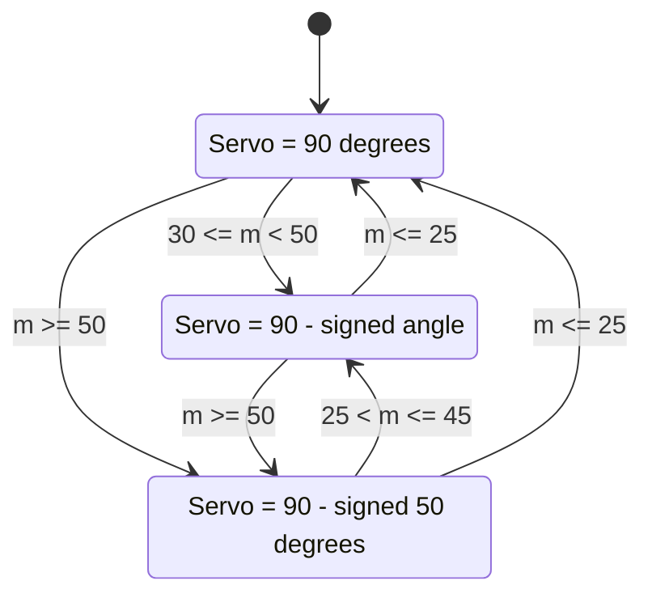
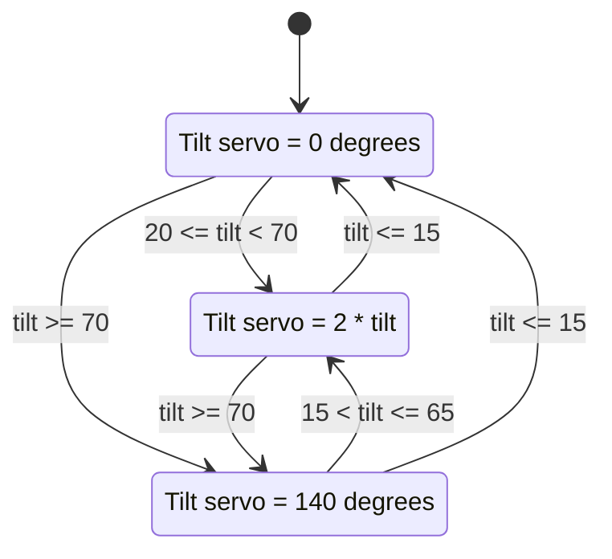

# Assignment 2: controller design and validation guide

This guide maps the assignment to the controller and provides **expected** test
results. It is not a record of a Wokwi run. Record actual simulator observations
and capture a video before treating these cases as submission evidence.

## Requirements and implementation locations

| Requirement | Implementation / inspection point | Useful check |
| --- | --- | --- |
| MPU6050 accelerometer input | I2C acquisition in `Core/Src/haptic_app.c` | Wake the sensor, select ±2 g range, read all six acceleration bytes in one burst, and decode signed big-endian samples. |
| Angle subroutine | `Core/Src/haptic_controller.c` | Check `roll = atan2f(ay, az)`, `pitch = atan2f(-ax, sqrtf(ay*ay + az*az))`, and `tilt = sqrtf(pitch*pitch + roll*roll)` in degrees. |
| Independent pitch and roll haptics | Reusable axis FSM in `Core/Src/haptic_controller.c` | Exercise each sign, each entry threshold, and each release threshold independently. |
| Combined tilt haptics | Tilt FSM in `Core/Src/haptic_controller.c` | Show tilt feedback while both individual axes remain free; then show the 140° tilt clamp. |
| Automatic autopilot | Mode logic in `Core/Src/haptic_controller.c` | Both axis FSMs clamped must latch autopilot. A tilt clamp alone must not latch it. |
| Button mode changes | PA12 acquisition/debounce in `Core/Src/haptic_app.c`; mode logic in controller | One event per debounced rising edge; manual can enter autopilot at any angle, while autopilot can leave only with both axes free. |
| Mode LEDs | PA2 and PB11 in `Core/Src/haptic_app.c` | PA2 on and PB11 off in autopilot; the inverse in manual mode. |
| Servo PWM and matched polling | TIM3 setup in `Core/Src/main.c`; control loop in `Core/Src/haptic_app.c` | 50 Hz PWM and one IMU/control update per 20 ms during normal operation. |
| Required hardware connections | `diagram.json`, GPIO setup, and `Core/Src/stm32c0xx_hal_msp.c` | Verify every pin in the table below. |

The accelerometer equations estimate static orientation from gravity. They do not
implement an aircraft dynamics model or distinguish gravity from manoeuvre
acceleration. A real autopilot is outside this assignment's simulated mode logic.

## Boundary choices

The brief omits equality at ±50° for individual axes and at 20° for tilt. This
implementation assigns equality to the more restrictive entering state:

| FSM | Enter compliant | Enter clamped | Release clamped | Release compliant |
| --- | --- | --- | --- | --- |
| Pitch or roll, magnitude `m = abs(angle)` | `m >= 30°` | `m >= 50°` | `m <= 45°` | `m <= 25°` |
| Tilt, magnitude `m = tilt` | `m >= 20°` | `m >= 70°` | `m <= 65°` | `m <= 15°` |

Release thresholds are inclusive. Outward transitions take precedence over
remaining in a lower state. A sample that jumps across two thresholds reaches
the correct state immediately, including a direct clamped-to-free transition
when the input returns below the free release threshold. Signed axes also handle
a jump from a positive angle to a negative angle without retaining a clamp on
the wrong side.

Hysteresis intentionally makes state depend on history. For example, an axis at
27° is free when approached from level but remains compliant when approached
from 40°. Test both paths.

The assignment does not define a different servo command law in autopilot.
Haptic feedback continues to represent measured orientation in both modes;
autopilot is a latched mode with its own LED. Returning to level does not
automatically restore manual mode. An unsafe button press is discarded, rather
than queued for later release. Release and press again after both individual
axes are free.

## FSM diagrams

The axis FSM below is reused for pitch and roll. The sign of the measured angle
sets the direction of the compliant command or clamp. `m` means the magnitude of
that angle; a sign reversal is handled before applying same-side hysteresis.

```mermaid
stateDiagram-v2
    [*] --> Manual
    Manual: Manual LED on; autopilot LED off
    Autopilot: Autopilot LED on; manual LED off
    Manual --> Autopilot: Both axes clamped OR fresh button press
    Autopilot --> Manual: Fresh button press AND both axes free
    Autopilot --> Autopilot: Unsafe button press OR no fresh press
```







For release from autopilot, both measured individual angles must also satisfy
the strict free-region requirement `abs(pitch) < 30°` and `abs(roll) < 30°`.
Tilt need not be free: two 20° individual angles satisfy the specified mode
release condition even though the unified tilt remains compliant.

## Hardware and timing

| Hardware | MCU pin | Configuration |
| --- | --- | --- |
| Roll servo | PB4 | TIM3 channel 1 PWM |
| Pitch servo | PB5 | TIM3 channel 2 PWM |
| Tilt servo | PB0 | TIM3 channel 3 PWM |
| Autopilot LED | PA2 | Push-pull output |
| Manual LED | PB11 | Push-pull output |
| MPU6050 SCL | PB8 | I2C1 alternate function, open drain, pull-up in diagram |
| MPU6050 SDA | PB9 | I2C1 alternate function, open drain, pull-up in diagram |
| Autopilot button | PA12 | Input with pull-down; pressed level is high |

With a 48 MHz timer clock, prescaler `47` gives one microsecond per count.
Auto-reload `19999` gives a 20,000 μs period, or 50 Hz. `HapticApp_Poll` checks
elapsed milliseconds and performs one sensor read and output update every 20 ms
during normal operation. The button is polled on every main-loop iteration,
debounced for 30 ms, and consumed at the next control update. Sensor recovery
attempts are limited to once per second after an I2C failure; this fault path is
separate from normal sampling.

The pulse conversion maps 0–180° to 544–2400 μs, matching Arduino Servo defaults;
neutral 90° is 1472 μs. The public
[Wokwi servo renderer](https://github.com/wokwi/wokwi-elements/blob/main/src/servo-element.ts)
applies a positive SVG rotation for increasing servo angles, which is clockwise.
Because the assignment defines clockwise as negative, pitch and roll use
`servo = 90 - angle` in the compliant region, and
`servo = 90 - direction * 50` when clamped. Thus positive angles move
counterclockwise and negative angles move clockwise from neutral. Tilt retains
the explicitly specified `2 * tilt` mapping. This direction choice is based on
the public renderer source, not an executed Wokwi simulation. Verify direction,
neutral, and endpoints visually in the simulator.

## Normalized accelerometer cases

For target pitch `theta` and roll `phi`, construct a gravity vector as follows,
using radians inside the trigonometric functions:

```text
ax = -sin(theta)
ay = cos(theta) * sin(phi)
az = cos(theta) * cos(phi)
```

Its magnitude is 1 g before rounding. The table rounds components to six decimal
places. Wokwi slider quantization can produce small angle differences. Use the
controller's measured angles for threshold demonstrations, and avoid claiming
an exact equality test from rounded slider values.

Start each independent case from a reset controller or hold level until both
axis FSMs and tilt FSM have returned to free. If autopilot was latched, press the
button at level to restore manual mode before the next independent case.

| Case | ax (g) | ay (g) | az (g) | Pitch / roll / tilt (degrees) | Expected pitch / roll / tilt servo positions (degrees) |
| --- | ---: | ---: | ---: | --- | --- |
| Level | 0 | 0 | 1 | 0 / 0 / 0 | 90 / 90 / 0 |
| Positive roll compliant | 0 | 0.642788 | 0.766044 | 0 / 40 / 40 | 90 / 50 / 80 |
| Negative roll compliant | 0 | -0.642788 | 0.766044 | 0 / -40 / 40 | 90 / 130 / 80 |
| Positive pitch compliant | -0.642788 | 0 | 0.766044 | 40 / 0 / 40 | 50 / 90 / 80 |
| Negative pitch compliant | 0.642788 | 0 | 0.766044 | -40 / 0 / 40 | 130 / 90 / 80 |
| Positive roll clamp | 0 | 0.866025 | 0.500000 | 0 / 60 / 60 | 90 / 40 / 120 |
| Negative roll clamp | 0 | -0.866025 | 0.500000 | 0 / -60 / 60 | 90 / 140 / 120 |
| Positive pitch clamp | -0.866025 | 0 | 0.500000 | 60 / 0 / 60 | 40 / 90 / 120 |
| Negative pitch clamp | 0.866025 | 0 | 0.500000 | -60 / 0 / 60 | 140 / 90 / 120 |
| Tilt feedback with both axes free | -0.342020 | 0.321394 | 0.883022 | 20 / 20 / 28.284 | 90 / 90 / 56.569 |
| Tilt clamp, axes still compliant | -0.761538 | 0.493568 | 0.420059 | 49.6 / 49.6 / 70.145 | 40.4 / 40.4 / 140 |
| Both individual axes clamped | -0.819152 | 0.469846 | 0.328990 | 55 / 55 / 77.782 | 40 / 40 / 140; autopilot latches |

“Roll only” and “pitch only” mean only that individual axis is compliant; unified
tilt also becomes compliant for a single 40° axis because its threshold is lower.
It is mathematically impossible to have an individual axis at 40° while keeping
the tilt below 20°.

## Stateful transition demonstrations

Keep the unused individual axis at zero. Use the normalized-vector formula above
to obtain the corresponding slider values for each angle in these sequences.

| Sequence | Expected states | Expected servo positions |
| --- | --- | --- |
| Positive axis: 0, 29, 30, 49, 50, 48, 45, 27, 25° | Free, free, compliant, compliant, clamped, clamped, compliant, compliant, free | 90, 90, 60, 41, 40, 40, 45, 63, 90° |
| Negative axis: 0, -29, -30, -49, -50, -48, -45, -27, -25° | Same state sequence | 90, 90, 120, 139, 140, 140, 135, 117, 90° |
| Tilt: 0, 19, 20, 69, 70, 68, 65, 18, 15° | Free, free, compliant, compliant, clamped, clamped, compliant, compliant, free | 0, 0, 40, 138, 140, 140, 130, 36, 0° |
| Axis jump: 0, 60, 0° | Free, clamped, free | 90, 40, 90° |
| Axis sign jump: 60, -60° | Positive clamp, negative clamp | 40, 140° |

For the tilt sequence, a single varying roll axis can set the desired tilt, but
it will also activate that roll axis's FSM. This sequence isolates the tilt FSM's
observations rather than keeping both individual axes free throughout.

Mode and robustness checks:

1. At level after startup, verify manual indication and all three neutral servo
   positions. Press once to enter autopilot and once again to return to manual.
2. Hold the button through several update cycles. Verify there is one transition,
   rather than a repeated toggle. Release and press again for the next event.
3. Enter the 55°/55° case. Verify autopilot engages without pressing the button.
   Return to level without a button press and verify autopilot remains latched.
4. In autopilot, press while either individual axis is outside its free region.
   Verify manual remains blocked. Keep holding while returning to level and
   verify there is no delayed release. Release, then press again to exit.
5. In autopilot, use the 20°/20° tilt-only case and make a fresh press. Both
   individual axes are free, so manual release is permitted despite tilt feedback.
6. Start the 49.6°/49.6° case from free in manual mode. Verify tilt clamps but
   autopilot remains off because neither individual axis is clamped.
7. Check a missing/disconnected IMU, failed I2C operation, and invalid zero-length
   acceleration vector. Record the implemented fault indication and neutral
   output behavior; do not describe stale sensor data as a valid orientation.

## Evidence still required for submission

The serial monitor on PA9/USART1 now reports a status line each second at
115200 baud. `IMU=OK` means the current acceleration sample was valid;
`mode=AUTO` may still be latched from an earlier fault and requires a safe,
fresh button press. `IMU=FAULT` identifies the failed operation and includes
the register address, WHO_AM_I value, HAL result and I2C error flags. Record
that exact line when diagnosing a red-only startup instead of inferring sensor
health from the mode LED.

Register transfers use `HAL_I2C_Mem_Read/Write` with 8-bit addresses. Reads use
a repeated START and a six-byte acceleration burst. Startup waits 100 ms after
waking the sensor; a failed bus connection is retried after reinitializing I2C.
Host tests exercise these API contracts and simulated wake/recovery conditions;
they do not execute the Wokwi peripheral model.

A hardware timeout now selects a bounded GPIO I2C fallback on the same PB8/PB9
lines. This still reads the actual MPU6050 and rejects NACKs, stuck lines,
invalid identity and invalid acceleration. Its protocol tests use a slave model
that decodes START, address, data and ACK/NACK edges; they are not Wokwi runs.
Check `bus=GPIO` and `IMU=OK` in the simulator to confirm actual communication.
`hwerr=0x00000020` preserves the original hardware failure; `err` is the current
bus result. Capture the exact line if the GPIO path also fails.

Build and host-side controller checks can validate compilation, angle equations,
FSM transitions, and command values. They do not establish that Wokwi rendered
the correct servo direction, that I2C transactions succeeded in the simulator,
or that the button/LED wiring works. Those require a simulator run and observation.

The assignment also requires a 1500–2000 word report PDF and a screen recording
that matches the reported test cases. Add the actual student name and ID to the
existing `lbl_name` text in `diagram.json`; do not leave its placeholder in a
submission. Use actual measured observations, rendered software FSM diagrams,
and appropriate acknowledgements. Package the complete project and actual
recording under the required student-ID filename. This guide does not supply a
fabricated report, recording, student identity, or simulator result.
